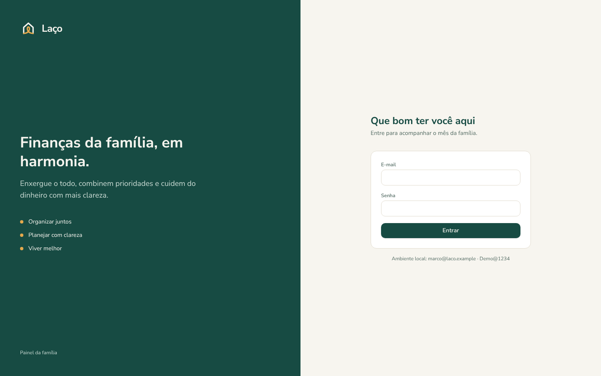
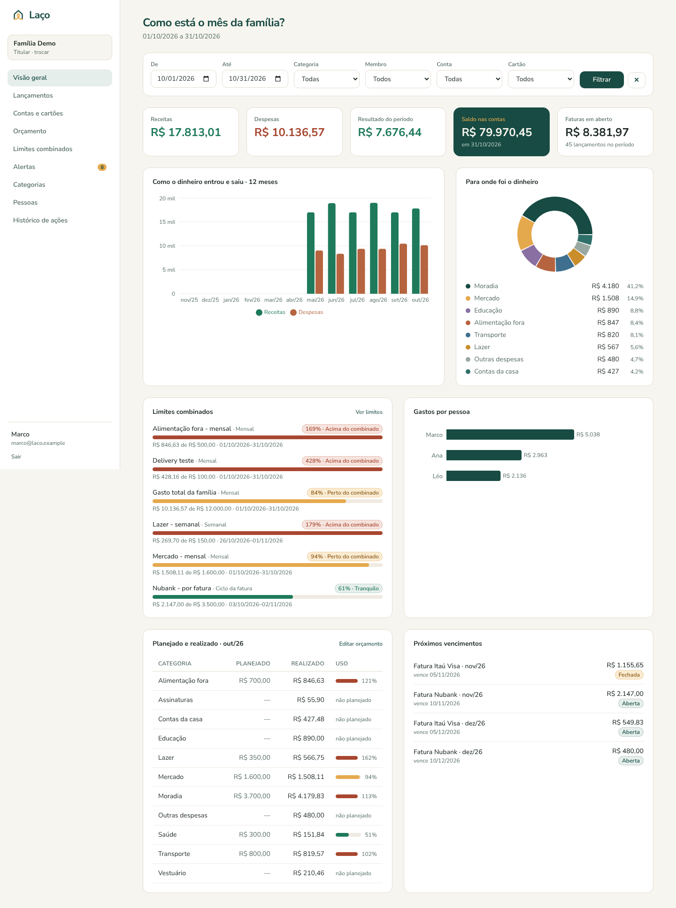

# Laço — API, banco local, painel web e app Android

> **Finanças da família, em harmonia.** Organizar juntos. Planejar com clareza. Viver melhor.

Código do documento de arquitetura: **API NestJS**, **banco MySQL instalado localmente** (sem Docker) com migrações, dados de demonstração e backup, **painel web Next.js** e **app Android em Flutter** (offline com sincronização, importação de extrato em PDF e leitura de nota fiscal). Todos falam só com a API; o MySQL fica acessível apenas a ela.

```
laco/
├─ packages/brand/           identidade Laço: tokens (cores, tipografia), logos SVG e guia de marca
├─ infra/mysql/
│  ├─ my.cnf.example         configuração recomendada do servidor MySQL local
│  └─ setup-manual.sql       alternativa manual ao db:setup (Workbench / sudo mysql)
├─ apps/api/                 NestJS + Kysely + MySQL
│  ├─ db/migrations/         SQL versionado (001 = modelo do documento, 002 = suporte ao app)
│  ├─ scripts/               db-setup, db-doctor, db-backup, db-restore, chaves JWT
│  ├─ src/                   módulos da API
│  ├─ test/                  25 testes e2e (isolamento, permissões, lançamentos, alertas, PDF, sync)
│  └─ openapi.json           contrato gerado (61 caminhos, 85 operações)
├─ apps/web/                 Next.js 15 (BFF): painel administrativo
└─ apps/mobile/              Flutter (Android): app da família — ver apps/mobile/README.md
```

## 1. Instalar o MySQL na máquina (uma vez)

Use o MySQL 8.4 LTS (o 8.0 também funciona). Anote a senha do usuário `root` definida na instalação.

| Sistema | Instalação | Iniciar o serviço |
| --- | --- | --- |
| Windows | `winget install Oracle.MySQL` ou o [MySQL Installer](https://dev.mysql.com/downloads/installer/) (opção "Server only"). Marque "Add to PATH" ou adicione `C:\Program Files\MySQL\MySQL Server 8.4\bin` ao PATH. | Já sobe como serviço `MySQL84` (services.msc) |
| macOS | `brew install mysql@8.4` e depois `mysql_secure_installation` | `brew services start mysql@8.4` |
| Ubuntu/Debian | `sudo apt install mysql-server` | `sudo systemctl enable --now mysql` |

Opcional, mas recomendado: aplique as configurações de `infra/mysql/my.cnf.example` (aceitar conexões só da própria máquina, utf8mb4, UTC, binlog para recuperação) e reinicie o serviço.

## 2. Preparar o banco do projeto

Pré-requisito: Node.js 22+.

```bash
cd apps/api
npm install
npm run keys        # cria o .env e gera as chaves JWT ES256
npm run db:setup    # pede a senha do root do MySQL; cria bancos e usuários; grava as senhas no .env
npm run db:migrate  # cria as tabelas
npm run db:seed     # família de demonstração com 6 meses de dados
npm run db:doctor   # confere conexão, versão, charset, privilégios e migrações
```

O `db:setup` é idempotente e cria:

| Item | Uso | Privilégios |
| --- | --- | --- |
| banco `laco` | dados da aplicação | — |
| banco `laco_test` | suíte de testes (recriada a cada `npm test`) | — |
| usuário `laco_app` | a API em execução | só `SELECT, INSERT, UPDATE, DELETE` |
| usuário `laco_migrator` | migrações, testes e backup | todos, apenas nesses dois bancos |

Os usuários só existem para `localhost`/`127.0.0.1`, então o banco não aceita esses logins de outra máquina. As senhas são geradas aleatoriamente e ficam apenas no `apps/api/.env` (fora do Git).

**Ubuntu/Debian**: o `root` costuma entrar sem senha via `sudo` (auth_socket). Nesse caso:

```bash
npm run db:setup -- --print-sql > setup.sql && sudo mysql < setup.sql && rm setup.sql
```

**Sem terminal / com MySQL Workbench**: execute `infra/mysql/setup-manual.sql` (trocando as duas senhas) e copie as senhas para `DB_PASSWORD` e `DB_MIGRATION_PASSWORD` no `.env`.

**Linux/macOS via socket**: preencha `DB_SOCKET` no `.env` (ex.: `/var/run/mysqld/mysqld.sock` ou `/tmp/mysql.sock`) para conectar sem TCP.

## 3. Rodar a API e o painel

```bash
# API: http://localhost:3001/api/v1 · Swagger em http://localhost:3001/api/docs
cd apps/api && npm run dev

# Painel: http://localhost:3000
cd apps/web
npm install
cp .env.example .env.local      # troque SESSION_SECRET (openssl rand -base64 32)
npm run dev
```

Logins de demonstração (senha `Demo@1234`):

| E-mail | Papel | Para testar |
| --- | --- | --- |
| marco@laco.example | OWNER | tudo, inclusive membros e auditoria |
| ana@laco.example | ADMIN | administração sem poderes de titular |
| leo@laco.example | MEMBER | não vê menu de membros; vê a conta restrita do Marco só para leitura |
| carla@outra.laco.example | OWNER de outra família | isolamento: a Família Demo devolve 404 |

### Comandos do banco (em `apps/api`)

| Comando | O que faz |
| --- | --- |
| `npm run db:setup` | cria/atualiza bancos e usuários no MySQL local |
| `npm run db:migrate` | aplica migrações pendentes (recusa migração já aplicada que foi alterada) |
| `npm run db:seed` | dados de demonstração |
| `npm run db:reset` | apaga as tabelas, recria e repopula (bloqueado em produção) |
| `npm run db:doctor` | diagnóstico: conexão, versão, utf8mb4, fuso, sql_mode, privilégio mínimo, migrações |
| `npm run db:backup` | `mysqldump` consistente e compactado em `apps/api/backups/` (mantém os 14 mais recentes) |
| `npm run db:restore -- <arquivo> --yes` | restaura um backup (substitui os dados atuais) |
| `npm test` | 20 testes e2e no banco `laco_test` |

Backup e restauração usam os utilitários `mysqldump` e `mysql` que vêm com o servidor. Se não estiverem no PATH, informe o caminho em `MYSQLDUMP_PATH` / `MYSQL_CLIENT_PATH`. As credenciais vão num arquivo temporário com permissão restrita, não na linha de comando. Para backup diário, agende `npm run db:backup` (Agendador de Tarefas no Windows, cron/launchd no Linux/macOS).

### Problemas comuns

| Mensagem do `db:doctor` / `db:setup` | Solução |
| --- | --- |
| `ECONNREFUSED` | o serviço do MySQL está parado ou em outra porta (`DB_PORT`) |
| `ER_ACCESS_DENIED…` no setup | senha do root errada; no Ubuntu use o caminho `--print-sql` + `sudo mysql` |
| `ER_ACCESS_DENIED…` no doctor | senha do `.env` diferente da do banco: rode `npm run db:setup` de novo |
| `Migrações pendentes` | `npm run db:migrate` |
| `consegue criar tabelas` | o usuário da API tem privilégio demais: `npm run db:setup` corrige os GRANTs |

## O que está implementado

**API** (`/api/v1`, erros em Problem Details RFC 9457, valores como string decimal, datas ISO 8601 UTC)

- Auth: cadastro, login com bloqueio após 5 falhas, access token JWT ES256 de 15 min, refresh token opaco rotativo com detecção de reuso (revoga a cadeia), logout.
- Famílias, membros, papéis (OWNER > ADMIN > MEMBER > VIEWER), convites por e-mail com validade de 7 dias, permissões por conta/cartão restritos, garantia de sempre haver um OWNER.
- Categorias (dois níveis, padrão criadas com a família, desativação preserva histórico), contas com saldo, cartões com faturas calculadas pelo dia de fechamento, pagamento de fatura.
- Lançamentos: categoria obrigatória e compatível, busca e filtros, paginação por cursor com totais, parcelados (centavos na 1ª parcela), transferências, edição com `If-Match` (concorrência otimista) e escopo para parcelas, exclusão lógica, impressão digital para detectar duplicatas, `Idempotency-Key` para reenvios do app offline.
- Orçamentos mensais e orçado × realizado.
- Limites (família, categoria, conta, cartão, membro; semanal, mensal, ciclo da fatura, personalizado) e alertas: um por limite+período+faixa (chave única no banco), histerese de 5 p.p., cursor incremental `GET /alerts?since=`, recibos de leitura por usuário, só o alerta mais grave vira push, limite anti-excesso de push.
- Dashboards: resumo, por categoria, por membro, série mensal, limites × realizado, orçado × realizado, vencimentos.
- **Importação de extrato/fatura em PDF** (`POST /families/:id/imports`, multipart): leitura do texto com pdf.js (sem executar código do PDF), PDF com senha, detecção de PDF escaneado, parser genérico de bancos brasileiros (datas, valores, parcelas "03/10"), duplicados exatos e prováveis (Jaro-Winkler) marcados para pular, categoria sugerida por regras aprendidas da família e por palavras-chave. Nada é gravado até `POST …/imports/:importId/confirm`, que cria todos os lançamentos numa transação e aprende as categorias escolhidas.
- **Recorrências** (`/families/:id/recurrences`): diária, semanal, mensal, anual; geração idempotente (chave única regra+data) por um agendador interno de hora em hora e por `POST /recurrences/run`.
- **Sincronização do app** (`GET /families/:id/sync/changes?since=`): lançamentos alterados e excluídos desde o cursor, mais categorias, contas com saldo, cartões e membros.
- **Anexos** (`/transactions/:id/attachments`, `GET /files/:fileId/content`): foto da nota até 8 MB, tipo conferido pelos bytes do arquivo, download só para quem pode ver o lançamento. Arquivos ficam em `STORAGE_DIR` (padrão `apps/api/storage/`, fora do git).
- Auditoria de todas as escritas relevantes, logs estruturados (pino) com `requestId`, rate limit (300/min geral, 10/min no login), helmet, CORS restrito.

**Isolamento por família em três camadas**: `FamilyGuard` (membro ativo, senão 404), filtro por `family_id` em todas as consultas e chaves estrangeiras compostas `(family_id, id)` no MySQL — o banco recusa um lançamento que aponte para a categoria de outra família (há teste para isso).

**Painel web**: login, escolha de família, dashboard com filtros na URL (período, categoria, membro, conta, cartão), lançamentos (filtros, busca, criação, parcelado, exclusão), contas e cartões com faturas, orçamentos editáveis, limites com consumo, alertas ativos e histórico, categorias, membros e convites, auditoria.

Como o painel consome a API e protege o acesso:

1. O navegador só fala com o servidor Next.js. A API e o MySQL não são expostos a ele.
2. No login, o servidor Next chama a API e guarda access e refresh token **criptografados** num cookie `httpOnly`, `SameSite=Strict` (o JavaScript da página não consegue ler o token; verificado no teste com Playwright).
3. O `middleware.ts` renova o access token antes de expirar (rotação do refresh) e encerra a sessão após 30 min de inatividade.
4. Páginas são Server Components que chamam a API com `Authorization: Bearer`; mutações são Server Actions (proteção nativa contra CSRF por verificação de origem).
5. A autorização real fica na API: o painel só esconde o que o papel não permite.

**App Android** (`apps/mobile`, Flutter): lançamentos offline com fila de envio e `Idempotency-Key`, sincronização incremental, início com limites e vencimentos, contas e faturas, orçamento, limites, alertas (verificação periódica e push FCM opcional), relatórios, importação de PDF com revisão, leitura de NFC-e (QR Code + ML Kit no aparelho) e convites por link. Pede só `INTERNET` e, com explicação, `POST_NOTIFICATIONS`: câmera, fotos e arquivos passam pelos seletores do sistema. Instruções e roteiro de validação em [`apps/mobile/README.md`](apps/mobile/README.md). **O código do app não foi compilado no ambiente em que foi gerado** (sem SDK Flutter): rode `flutter analyze` e `flutter test` primeiro.

## Identidade visual e tom de voz

A identidade do Laço vive em `packages/brand/` e é a fonte única para o painel e o futuro app Flutter. O guia completo, com contrastes verificados, está em [`packages/brand/BRAND.md`](packages/brand/BRAND.md).

- **Cores**: verde profundo `#174B43` (principal), dourado suave `#E5A94D` (metas e progresso, só em preenchimentos), fundo `#F7F5EF`, verde acinzentado `#526A62` (texto de apoio). Para valores: `#1E7A5A` em receitas e terracota `#A8462F` em despesas e "acima do combinado", no lugar de um vermelho de alarme.
- **Tokens**: edite `tokens.json` e rode `node packages/brand/build.mjs`. Isso gera `tokens.css`, que o Tailwind do painel consome com nomes semânticos (`bg-verde`, `text-apoio`, `text-despesa`), e `apps/mobile/lib/core/theme/laco_tokens.dart` para o Flutter.
- **Logo**: símbolo (casa cuja base forma um laço), versão monocromática, negativo, ícone de app e logo horizontal. Os arquivos são **provisórios**: foram desenhados a partir da descrição da proposta e devem ser trocados pelo SVG oficial mantendo os nomes.
- **Tipografia**: Nunito Sans, servida pelo próprio painel (`@fontsource-variable/nunito-sans`), sem requisição a terceiros.
- **Tom de voz**: "Como está o mês da família?", "Limites combinados", "Perto do combinado", "Acima do combinado", "Ainda livre". As mensagens da API também explicam o próximo passo em vez de expor códigos internos.

### Vindo da versão FinFamília

O banco, os usuários e os tokens mudaram de nome (`laco`, `laco_app`, `laco_migrator`, emissor JWT `laco-api`). No ambiente local:

```bash
cd apps/api
# no .env, troque finfamilia → laco em DB_NAME, DB_TEST_NAME, DB_USER, DB_MIGRATION_USER, JWT_ISSUER (laco-api) e JWT_AUDIENCE (laco)
npm run db:setup && npm run db:migrate && npm run db:seed
```

Opcionalmente, apague o banco e os usuários antigos no MySQL (`DROP DATABASE finfamilia; DROP DATABASE finfamilia_test; DROP USER 'finfamilia_app'@'localhost', …`). As sessões abertas no painel expiram e é preciso entrar de novo. A migração `001_initial_schema.sql` mantém o nome antigo num comentário de propósito: migrações já aplicadas são imutáveis (o migrador confere o checksum).

## Diferenças em relação ao documento (decisões desta fase)

| Documento | Aqui | Motivo |
| --- | --- | --- |
| Prisma ORM | **Kysely** (query builder tipado) + migrações SQL | O Prisma não representa bem FKs compostas com colunas opcionais `(family_id, account_id)`, que são o coração do isolamento no banco. Com SQL versionado o DDL do documento vale como está. |
| IDs `BINARY(16)` | `CHAR(36)` ASCII | Mais legível durante testes e depuração. Migração para `BINARY(16)` é mecânica quando o volume justificar. |
| MySQL gerenciado na nuvem (RDS) | MySQL instalado localmente, usuários separados para API e migrações | Fase de testes local; a separação de privilégios já é a mesma prevista para produção. |
| BullMQ + Redis para avaliar limites | Avaliação síncrona após cada escrita, com `SELECT … FOR UPDATE` no limite | Um serviço a menos para rodar localmente; o `LimitsService` já está isolado para ir para uma fila. |
| Fila para PDF/OCR e S3/MinIO | PDF processado na requisição; arquivos em disco local (`STORAGE_DIR`); OCR da nota no próprio celular | Extratos têm poucas páginas; o `StorageService` é o ponto para trocar por S3. O OCR no aparelho evita enviar a foto. |
| Drift no app | sqflite com SQL simples | Sem geração de código, o que facilita validar o app sem `build_runner`. |
| Push FCM | Simulado (log) com a regra anti-excesso real | Requer projeto Firebase; o ponto de integração é `PushService`. |
| Proxy `/api/bff/*` | Server Components + Server Actions | Mesmo efeito (tokens só no servidor) com menos superfície. |

## Próximas etapas sugeridas

1. Validar o app num aparelho real (`flutter analyze`, `flutter test`, build) e ajustar o que aparecer.
2. Parsers específicos para os bancos mais usados pela família (o registro de parsers já aceita novos).
3. FCM real na API (hoje simulado), e-mail transacional para convites, 2FA para OWNER, CSP com nonce no painel.
4. Armazenamento de arquivos em S3/MinIO e fila para importações grandes.




